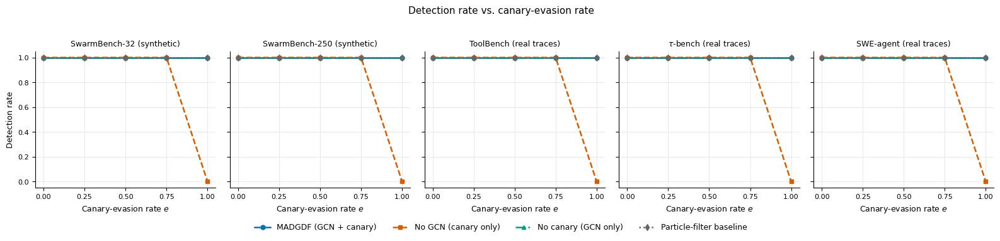
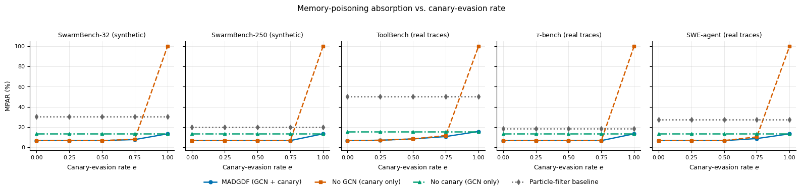

# MADGDF: Dual-Channel Detection of Memory Poisoning in Multi-Agent Systems

## Overview

**MADGDF** (Multi-Agent Distributed Graph-State Deception Framework) is a research-driven framework for detecting memory poisoning in retrieval-augmented multi-agent systems. It combines two independent detection channels:

- **Graph-state channel**: a self-supervised two-layer GCN (16→32→8) that monitors how each agent's embedding drifts from its clean reference.
- **Shadow-memory canary channel**: a marker string placed in an isolated shadow-memory area and checked against each agent's simulated retrievals.

The two channels are fused with **OR logic**: an alert from either channel raises a breach flag. The framework is evaluated under progressive canary evasion, from no evasion to complete suppression of the canary signal.

> **Scope:** All results come from a single-process simulation with synthetic interaction graphs and a synthetic compromise overlay. They describe the implemented protocol and are not a guarantee of security in deployed agent systems.

## Key Features

- Dual-channel detection (graph-state divergence OR canary verification)
- Self-supervised GCN pre-trained by link prediction on a clean warm-up window, then frozen
- Time-causal interaction graphs (no future edges visible at decision time)
- Two-step persistence rule for graph alerts (divergence above τ in two consecutive steps)
- Canary-evasion evaluation: e = 0.00, 0.25, 0.50, 0.75, 1.00
- Detector ablation: FULL, NO_GNN (canary only), NO_CANARY (graph only), BASELINE (local EWMA)
- Five evasion routes, temporal-leakage ablation, and a drift-throttling stress test
- Five evaluation sources × 20 seeds (1000–1019)
- Reproducible Colab notebook, scripts, tables, and figures

## Installation

### Clone Repository

```bash
git clone https://github.com/shailinsta/MADGDF-NEW.git
cd MADGDF-NEW
```

### Install Dependencies

```bash
pip install -r requirements.txt
```

## Running the Experiments

Two entry points are provided:

| File | Purpose |
|------|---------|
| `MADGDFColab_.ipynb` | Colab notebook that runs the full experiment suite and produces the tables and figures |
| `madgdf__colab_.py` | Script version of the same pipeline |

**Option A: Google Colab**
Upload `MADGDFColab_.ipynb` to Colab and run all cells.

**Option B: Local**

```bash
python madgdf__colab_.py
```

See `MADGDF_PostReview_Colab_NOTE.md` for notes on the post-review notebook revisions.

## Repository Structure

```
MADGDF-NEW/
│
├── README.md
├── LICENSE                              # MIT
├── CITATION.cff                         # Citation metadata
├── zenodo_madgdf_metadata.json          # Research-archive metadata
├── requirements.txt
│
├── MADGDFColab_.ipynb                   # Experiment notebook
├── madgdf__colab_.py                    # Experiment script
├── MADGDF_PostReview_Colab_NOTE.md      # Post-review notes
│
├── Fig3_detection_rate_vs_evasion.png
├── Fig4_MPAR_vs_evasion.png
├── Fig5_FPR_e0_e1.png
├── Fig6_graph_precision_recall.png
├── Fig7_encoder_training.png
├── Fig8_divergence_separation.png
├── Fig9_temporal_leakage.png
├── Fig10_evasion_routes.png
├── Fig11_drift_throttling.png
│
├── Table3_detection_rate.csv
├── Table4_MPAR.csv
├── Table5_FPR.csv
├── Table6_latency_SwarmBench32.csv
├── Table7_precision_recall_SwarmBench32.csv
├── Table8_state_of_the_art_comparison.csv
└── Table_RQ_summary.csv
```

## Pipeline Workflow

1. Build clean warm-up data and interaction graphs
2. Train the GCN encoder with a link-prediction objective (binary cross-entropy)
3. Freeze the encoder and store clean reference embeddings H₀
4. Calibrate the divergence threshold τ (95th percentile of divergence on held-out clean data)
5. Inject compromised-agent behavior with a configurable canary-evasion rate
6. At each step, build the time-causal graph and compute graph-state divergence
7. Apply the two-step persistence rule to produce graph alerts
8. Inspect each agent's retrieval set for the canary string
9. Fuse the channels with OR logic into agent-level breach flags and a global detection flag
10. Record detection rate, MPAR, FPR, and latency across all configurations and seeds

## Detection Model

**Graph-state divergence** (Euclidean distance to the clean reference embedding):

```
d(i,t) = || H(t,i) − H(0,i) ||₂
```

**Graph alert:** raised when `d(i,t) > τ` in two consecutive steps.

**Canary indicator:** 1 if the canary string occurs in any retrieved chunk, else 0.

**Fusion:**

```
Breach(i,t) = GraphAlert(i,t) OR Canary(i,t)
Detect(t)   = 1 if any agent has Breach(i,t) = 1
```

| Component | Description |
|-----------|-------------|
| Graph channel | Frozen GCN, divergence from clean reference, two-step persistence |
| Canary channel | Substring match against the shadow-memory marker |
| Fusion | Logical OR at the agent level, any-agent rule at the global level |

## Evaluation Sources

| Source | Agents | Divergence threshold τ | Link-prediction AUC |
|--------|-------:|-----------------------:|--------------------:|
| SwarmBench-32 | 32 | 0.2503 | 0.982 |
| SwarmBench-250 | 250 | 0.2620 | 0.935 |
| ToolBench | 15 | 0.4762 | 0.982 |
| tau-bench | 1,980 | 0.2611 | 0.914 |
| SWE-agent | 18 | 0.2858 | 0.966 |

ToolBench, tau-bench, and SWE-agent provide workload-derived behavior. The interaction graphs and compromise overlays are synthetic.

## Detector Configurations

| Configuration | Description |
|---------------|-------------|
| `FULL` | Graph-state divergence OR canary inspection |
| `NO_GNN` | Canary detection only |
| `NO_CANARY` | Graph-state divergence only |
| `BASELINE` | Local EWMA anomaly detection |

## Evaluation Metrics

- **Detection rate**: fraction of runs in which the injected compromise is flagged (run-level, not agent-level)
- **MPAR**: memory poisoning absorption rate, the percentage of poisoned retrievals executed before the first breach alert
- **FPR**: percentage of clean agents incorrectly flagged
- **MADL**: multi-agent detection latency in milliseconds from step start to first breach flag
- **Precision / Recall**: agent-level, reported for the graph channel at complete evasion

## Experimental Results

### Detection Rate under Canary Evasion

| Evasion rate | FULL | NO_GNN | NO_CANARY | BASELINE |
|--------------|:----:|:------:|:---------:|:--------:|
| 0.00 – 0.75 (all sources) | 1.00 | 1.00 | 1.00 | 1.00 |
| 1.00 (all sources) | 1.00 | 0.00 | 1.00 | 1.00 |

### MPAR at Complete Evasion (e = 1.00)

| Source | FULL | NO_GNN | NO_CANARY | BASELINE |
|--------|-----:|-------:|----------:|---------:|
| SwarmBench-32 | 13.33 | 100.00 | 13.33 | 30.50 |
| SwarmBench-250 | 13.33 | 100.00 | 13.33 | 20.00 |
| ToolBench | 15.67 | 100.00 | 15.67 | 50.00 |
| tau-bench | 13.33 | 100.00 | 13.33 | 18.25 |
| SWE-agent | 13.33 | 100.00 | 13.33 | 27.25 |

When the canary is available (low evasion), FULL and NO_GNN reach MPAR of 6.67% on every source.

### Graph Channel Precision and Recall (SwarmBench-32, e = 1.00, 20 seeds)

| Metric | Value |
|--------|------:|
| Compromise prevalence | 0.1875 |
| Precision (mean ± SD) | 0.4565 ± 0.1471 |
| Recall (mean ± SD) | 0.7833 ± 0.1675 |

### Detection Latency (SwarmBench-32, mean ms)

| Evasion rate | FULL | NO_GNN | NO_CANARY | BASELINE |
|--------------|-----:|-------:|----------:|---------:|
| 0.00 | 2.77 ± 0.52 | 0.27 ± 0.07 | 5.50 ± 1.23 | 6.72 ± 2.00 |
| 0.25 | 2.36 ± 0.10 | 0.31 ± 0.07 | 4.75 ± 0.64 | 5.67 ± 1.09 |
| 0.50 | 2.40 ± 0.08 | 0.35 ± 0.07 | 4.81 ± 0.57 | 5.64 ± 1.17 |

### Additional Experiments

- **Temporal leakage (e = 1.0):** a graph that sees future interactions does not outperform the time-causal graph. On SwarmBench-250 and tau-bench the two are identical; on SwarmBench-32, ToolBench, and SWE-agent the leaky graph is worse (MPAR rises from 13.33% to 16.00%, 22.67%, and 18.67%).
- **Evasion routes (naive, strip, discover, suppress, stealth):** FULL detects every route on all five sources except stealth on ToolBench (0.9). Canary-only detects only the naive route. Graph-only performs almost as well as FULL.
- **Drift throttling (graph channel only):** detection stays at 1.0 for throttling factors of 0.5 and above. At 0.10 and 0.05, detection falls to as low as 0.8 (SwarmBench-32), 0.7 (ToolBench), and 0.6 then 0.3 (SWE-agent). A patient attacker can therefore evade the graph channel.

## Key Insights

- Graph-state monitoring provides a **complementary detection signal** when the canary is fully suppressed; canary-only detection falls to 0.00 detection and 100% MPAR.
- While the canary is available, FULL and canary-only have the same detection rate and MPAR.
- FULL and graph-only have the same run-level detection rate at complete evasion, so a detection-rate advantage of the hybrid over graph-only is **not established**.
- A run-level detection rate of 1.00 does not mean every compromised agent was found. Graph-only precision is below 0.5.
- FULL costs more latency than canary-only but less than graph-only and EWMA on SwarmBench-32.
- The graph channel loses sensitivity when the attacker slows its drift.

## Research Questions

| RQ | Question |
|----|----------|
| RQ1 | What extra detection evidence does graph-state monitoring give over canary-only monitoring as the canary is suppressed? |
| RQ2 | How does the canary-evasion rate affect detection rate and MPAR? |
| RQ3 | What latency and security trade-offs appear when both channels run together? |

A summary of findings is in `Table_RQ_summary.csv`.

## Results Figures (Section 5)

| File | Manuscript figure |
|------|-------------------|
| `Fig3_detection_rate_vs_evasion.png` | Fig. 3: Detection rate versus canary-evasion rate |
| `Fig4_MPAR_vs_evasion.png` | Fig. 4: MPAR versus canary-evasion rate |
| `Fig5_FPR_e0_e1.png` | Fig. 5: False-positive rate at zero and complete evasion |
| `Fig6_graph_precision_recall.png` | Fig. 6: Graph-channel precision and recall at e = 1.0 (20 seeds) |
| `Fig7_encoder_training.png` | Fig. 7: Encoder training on the clean warm-up window |
| `Fig8_divergence_separation.png` | Fig. 8: Divergence separation under time-causal graphs |
| `Fig9_temporal_leakage.png` | Fig. 9: Effect of temporal leakage (e = 1.0) |
| `Fig10_evasion_routes.png` | Fig. 10: Detection rate under the five evasion routes |
| `Fig11_drift_throttling.png` | Fig. 11: Graph-channel detection under drift throttling |




## Results Tables (CSV, UTF-8)

| File | Content |
|------|---------|
| `Table3_detection_rate.csv` | Run-level detection rate |
| `Table4_MPAR.csv` | Memory poisoning absorption rate |
| `Table5_FPR.csv` | False-positive rate |
| `Table6_latency_SwarmBench32.csv` | Detection latency |
| `Table7_precision_recall_SwarmBench32.csv` | Graph-channel precision and recall |
| `Table8_state_of_the_art_comparison.csv` | Qualitative comparison with related work |
| `Table_RQ_summary.csv` | Research-question summary |

> Figures are the images embedded in the manuscript. Use the original PNG/PDF files from the experiment notebooks for publication quality.

## Research Contributions

1. A dual-channel framework combining self-supervised graph-state monitoring with shadow-memory canary verification under OR fusion
2. A progressive canary-evasion evaluation across five evasion rates and five evaluation sources
3. Detector ablation (FULL, NO_GNN, NO_CANARY, BASELINE) analysed with detection rate, MPAR, FPR, and latency
4. A temporal-leakage ablation supporting the time-causal graph design
5. Evasion-route and drift-throttling stress tests that expose the limits of the graph channel
6. Public code, notebooks, tables, and figures for reproducibility

## Limitations

- Single-process simulation; interaction graphs and compromise overlays are synthetic
- Static canary only; adaptive attackers who discover the marker are not covered by the canary results
- Graph-channel precision is low (0.46), and recall drops under slow-drift attacks
- Latency is reported only for SwarmBench-32 at e = 0.00, 0.25, and 0.50
- Divergence thresholds are calibrated per source, so results depend on the quality of the clean calibration data

## Important Notes

- Run the notebook or script from the repository root so relative paths resolve correctly.
- Seeds 1000–1019 are used for all 20 runs per setting (5 sources × 5 evasion rates × 4 detectors × 20 seeds).
- Use the original experiment outputs, not the README previews, for publication-quality figures.

## Citation

If you use this work, please cite it using the metadata in [`CITATION.cff`](CITATION.cff) (GitHub's "Cite this repository" button also reads it). Archive metadata is in `zenodo_madgdf_metadata.json`.

## Authors

| Name | Affiliation |
|------|-------------|
| Shailendra Mishra (corresponding author) | Majmaah University, Saudi Arabia |
| Megha Rathi | Jaypee Institute of Information Technology, Noida, India |
| Saumya Mishra | MNNIT, Prayagraj, India |
| Saumitya Srivastava | Jaypee Institute of Information Technology, Noida, India |
| Wazdan Ali Almuteri | Majmaah University, Saudi Arabia |

## License

Released under the [MIT License](LICENSE).
